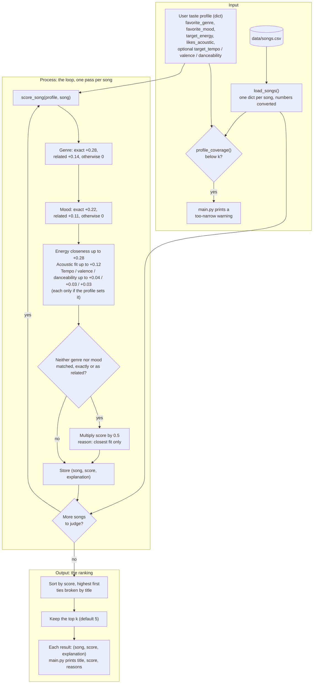

# 🎵 Music Recommender Simulation

## Project Summary

In this project you will build and explain a small music recommender system.

Your goal is to:

- Represent songs and a user "taste profile" as data
- Design a scoring rule that turns that data into recommendations
- Evaluate what your system gets right and wrong
- Reflect on how this mirrors real world AI recommenders

Replace this paragraph with your own summary of what your version does.

---

## How The System Works

Real-world recommenders like Spotify and YouTube Music combine two ideas. Collaborative filtering looks at what millions of other listeners played, skipped, saved, and repeated, and suggests songs that people with similar habits enjoyed. Content-based filtering looks at the songs themselves (genre, mood, tempo, energy, and so on) and finds ones similar to what you already like. Production systems blend these signals, add context such as time of day, and rank a huge catalog in stages.

My version is a small content-based recommender. It has no listening history from other users, only a 20-song catalog and one user's stated taste, so it can only compare songs to a profile.

**The plan**

1. **Input:** a taste profile (favorite genre, favorite mood, target energy, whether the user likes acoustic music, plus optional tempo, valence and danceability targets) and the song catalog loaded from `data/songs.csv`.
2. **Process:** loop over every song and give it a score from 0 to 1 by adding weighted points. Genre and energy count most (0.28 each), then mood (0.22), then acoustic fit (0.12), with small optional tempo, valence and danceability terms (0.04, 0.03, 0.03). Energy and the other numeric features are scored by how *close* a song is to the target, not by whether it is higher or lower. Related genres and moods earn half credit, and songs that match neither genre nor mood are halved.
3. **Output:** sort by score, break ties by title, and return the top `k` (default 5), each with a plain-language reason built from its point contributions. If a profile matches too few songs, a warning says the profile may be too narrow.

The data flow chart and the full scoring rules are below.

### Features used in the simulation

**`Song`** (one row of `data/songs.csv`)

| Feature | Type | Used in scoring? |
|---|---|---|
| `id`, `title`, `artist` | int / str | No, identification and display only (`title` breaks ties) |
| `genre` | str | Yes, exact match with the user's favorite genre (weight 0.28), half credit for a related genre |
| `mood` | str | Yes, exact match with the user's favorite mood (weight 0.22), half credit for a related mood |
| `energy` | float, 0-1 | Yes, Gaussian closeness to the user's target energy (weight 0.28) |
| `acousticness` | float, 0-1 | Yes, rewarded if the user likes acoustic, otherwise the inverse (weight 0.12) |
| `tempo_bpm`, `valence`, `danceability` | int / float | Yes, but only when the profile sets a target; small closeness terms (weights 0.04, 0.03, 0.03) |

**`UserProfile`**

| Feature | Type | Compared against |
|---|---|---|
| `favorite_genre` | str | `Song.genre` |
| `favorite_mood` | str | `Song.mood` |
| `target_energy` | float, 0-1 | `Song.energy` |
| `likes_acoustic` | bool | `Song.acousticness` |
| `target_tempo`, `target_valence`, `target_danceability` | optional float | `Song.tempo_bpm`, `Song.valence`, `Song.danceability` |

### Data Flow



### Algorithm Recipe

Every song in the catalog is scored against the user's profile with the same rules, then the songs are ranked. The weights sum to 1.0, so a score always falls between 0 and 1. This is the final version, and it is what `score_song()` in `src/recommender.py` implements.

In one line:

```
score = genre (0.28) + mood (0.22) + energy (0.28) + acoustic (0.12) + tempo/valence/danceability (0.04 + 0.03 + 0.03)
        then x 0.5 if neither genre nor mood matched, exactly or as a related label
```

#### Step 1: Score each feature (points)

| Rule | Points |
|---|---|
| **Genre**: exact match with `favorite_genre` | +0.28 |
| **Genre, related**: same family (pop / indie pop, rock / metal, lofi / ambient / jazz, folk / country / blues, edm / synthwave) | +0.14 (half credit) |
| **Mood**: exact match with `favorite_mood` | +0.22 |
| **Mood, related**: same family (chill / relaxed / peaceful / laid-back / focused, intense / aggressive, happy / euphoric / festive, melancholy / sorrowful / nostalgic) | +0.11 (half credit) |
| **Energy closeness**: `0.28 × exp(-(energy - target_energy)² / (2 × 0.25²))` | 0 to +0.28, full points at the target and fading smoothly in both directions |
| **Acoustic fit**: `0.12 × acousticness` if `likes_acoustic`, otherwise `0.12 × (1 - acousticness)` | 0 to +0.12 |
| **Tempo, valence, danceability closeness** (optional, only if the profile sets `target_tempo`, `target_valence`, `target_danceability`) | up to +0.04, +0.03, +0.03 |

#### Step 2: Apply the penalty

If a song matches neither genre nor mood, not even as a related one, its total is multiplied by 0.5 and its explanation says "closest fit only". This keeps a song that is merely the right energy and texture from outranking real genre or mood matches, and tells the reader it is filler.

#### Step 3: Rank and return

Sort by score from highest to lowest, break ties alphabetically by title so results are reproducible, and return the top `k` (default 5). Each result carries the list of point contributions as its plain-language explanation.

#### Design choices

- Genre and energy are tied for the most weight (0.28 each), with mood close behind (0.22). Acousticness is a smaller nudge (0.12).
- Energy uses closeness to a target, not "higher is better", so a calm listener is not handed loud songs and an intense listener is not handed sleepy ones.
- Genre and mood are exact matches first, but related labels earn half credit. "Indie pop" is no longer worth nothing to a "pop" fan, and a jazz "relaxed" song can still reach a "chill lofi" listener.
- The tempo, valence and danceability terms are small. Their job is to separate songs that would otherwise tie, such as two penalized near-misses with the same energy.
- Different profiles get different results because only the profile changes. The "Chill Lofi" profile (lofi / chill / 0.40 energy / acoustic) and the "Intense Rock" profile (rock / intense / 0.92 energy / not acoustic) have no overlap in their top 3.
- `profile_coverage()` counts how many songs match a profile's genre or mood, exactly or as a relative. A low count means the profile is too narrow for the catalog, and `main.py` prints a warning. Intense Rock still triggers it (3 matches, 5 requested).

**Worked example** (Chill Lofi profile, song "Coffee Shop Stories": jazz, relaxed, energy 0.37, acousticness 0.89, tempo 90, valence 0.71, danceability 0.54)

```
genre related (jazz ~ lofi)   +0.14
mood related (relaxed ~ chill) +0.11
energy        0.28 × exp(-(0.37 - 0.40)² / 0.125) = +0.28
acoustic fit  0.12 × 0.89                          = +0.11
tempo / valence / danceability                     = +0.10
total                                                0.73
```

Under the earlier all-or-nothing rules this song scored 0.22. For comparison, "Library Rain" (lofi, chill) scores 0.98 and "Neon Pulse" (edm, euphoric, a poor fit) is penalized down to 0.03.

#### Expected biases

This is a hand-tuned system on a 20-song catalog, so I expect these biases and gaps:

- **It may over-prioritize genre and ignore great mood matches.** Genre is worth 0.28 against 0.22 for mood, so a song in the right genre with the wrong feel can outrank a song that fits the mood perfectly. In the Chill Lofi results, Focus Flow (lofi, only a related mood) scores 0.86 and beats Spacewalk Thoughts (ambient, an exact "chill" match) at 0.80. Someone who cares about mood more than genre is served worse than someone who cares about genre.
- **Genres and moods outside my "families" get no leniency.** I wrote the families by hand. Hip hop, classical, r&b, reggae and latin have no related genre, and "moody", "confident" and "romantic" have no related mood. Fans of those get all-or-nothing matching while pop, rock and lofi fans get partial credit.
- **The catalog favors some tastes.** There are 17 genres across 20 songs. Lofi has 3 songs and pop has 2, so those listeners get several exact matches. Most other genres have exactly one, so their lists are padded with penalized near-misses (Intense Rock only matches 3 songs for 5 slots).
- **One favorite genre and one favorite mood.** A listener who likes both jazz and metal cannot be described, and the profile is stated, not learned, so it can be wrong or out of date.
- **Fixed, subjective weights.** The numbers are my judgment, not learned from listener behavior. Moving 0.07 or more of weight from genre to mood (0.20 genre, 0.30 mood) swaps positions 3 and 4 of the Chill Lofi results; at 0.23 / 0.27 the two are within 0.01.
- **Closeness assumes a single sweet spot.** A listener who enjoys both very calm and very intense music would be scored poorly by a single target energy.
- **Tie-breaking is alphabetical.** When scores are exactly equal, songs earlier in the alphabet are shown first, which has nothing to do with quality.

**Quick answers**

- **What features does each `Song` use?** Genre, mood, energy and acousticness always; tempo, valence and danceability when the profile asks for them. `id`, `title` and `artist` are for display and tie-breaking only.
- **What does the `UserProfile` store?** A favorite genre, favorite mood, target energy, an acoustic preference, and optional tempo, valence and danceability targets.
- **How is a score computed?** Each song is scored against the profile with the same weighted rules in the Algorithm Recipe above, then halved if neither genre nor mood matches.
- **How are songs chosen?** All songs are scored, sorted highest first, and the top `k` are returned.

---

## Getting Started

### Setup

1. Create a virtual environment (optional but recommended):

   ```bash
   python -m venv .venv
   source .venv/bin/activate      # Mac or Linux
   .venv\Scripts\activate         # Windows

2. Install dependencies

```bash
pip install -r requirements.txt
```

3. Run the app:

```bash
python -m src.main
```

### Running Tests

Run the starter tests with:

```bash
pytest
```

You can add more tests in `tests/test_recommender.py`.

---

## Sample Recommendation Output

This is the terminal output of `python -m src.main`, which runs three profiles against the 20-song catalog and shows the top 5 for each with their scores and reasons:

```
================================================================
  Chill Lofi: lofi / chill / energy 0.40 / acoustic
================================================================

1. Library Rain  (by Paper Lanterns)
   Score 0.98  [####################]
   Why:
     - genre match (lofi) +0.28
     - mood match (chill) +0.22
     - energy 0.35 vs target 0.40 +0.27
     - acoustic fit +0.10
     - tempo 72 vs target 78 +0.04
     - valence 0.6 vs target 0.58 +0.03
     - danceability 0.58 vs target 0.6 +0.03

2. Midnight Coding  (by LoRoom)
   Score 0.96  [###################.]
   Why:
     - genre match (lofi) +0.28
     - mood match (chill) +0.22
     - energy 0.42 vs target 0.40 +0.28
     - acoustic fit +0.09
     - tempo 78 vs target 78 +0.04
     - valence 0.56 vs target 0.58 +0.03
     - danceability 0.62 vs target 0.6 +0.03

3. Focus Flow  (by LoRoom)
   Score 0.86  [#################...]
   Why:
     - genre match (lofi) +0.28
     - related mood (focused ~ chill) +0.11
     - energy 0.40 vs target 0.40 +0.28
     - acoustic fit +0.09
     - tempo 80 vs target 78 +0.04
     - valence 0.59 vs target 0.58 +0.03
     - danceability 0.6 vs target 0.6 +0.03

4. Spacewalk Thoughts  (by Orbit Bloom)
   Score 0.80  [################....]
   Why:
     - related genre (ambient ~ lofi) +0.14
     - mood match (chill) +0.22
     - energy 0.28 vs target 0.40 +0.25
     - acoustic fit +0.11
     - tempo 60 vs target 78 +0.03
     - valence 0.65 vs target 0.58 +0.03
     - danceability 0.41 vs target 0.6 +0.02

5. Coffee Shop Stories  (by Slow Stereo)
   Score 0.73  [###############.....]
   Why:
     - related genre (jazz ~ lofi) +0.14
     - related mood (relaxed ~ chill) +0.11
     - energy 0.37 vs target 0.40 +0.28
     - acoustic fit +0.11
     - tempo 90 vs target 78 +0.04
     - valence 0.71 vs target 0.58 +0.03
     - danceability 0.54 vs target 0.6 +0.03


================================================================
  Intense Rock: rock / intense / energy 0.92 / not acoustic
================================================================
! Profile may be too narrow: only 3 songs match genre or mood (fewer than the 5 requested).

1. Storm Runner  (by Voltline)
   Score 0.99  [####################]
   Why:
     - genre match (rock) +0.28
     - mood match (intense) +0.22
     - energy 0.91 vs target 0.92 +0.28
     - acoustic fit +0.11
     - tempo 152 vs target 155 +0.04
     - valence 0.48 vs target 0.45 +0.03
     - danceability 0.66 vs target 0.65 +0.03

2. Iron Cathedral  (by Black Ember)
   Score 0.72  [##############......]
   Why:
     - related genre (metal ~ rock) +0.14
     - related mood (aggressive ~ intense) +0.11
     - energy 0.97 vs target 0.92 +0.27
     - acoustic fit +0.12
     - tempo 168 vs target 155 +0.03
     - valence 0.28 vs target 0.45 +0.02
     - danceability 0.45 vs target 0.65 +0.02

3. Gym Hero  (by Max Pulse)
   Score 0.67  [#############.......]
   Why:
     - mood match (intense) +0.22
     - energy 0.93 vs target 0.92 +0.28
     - acoustic fit +0.11
     - tempo 132 vs target 155 +0.03
     - valence 0.77 vs target 0.45 +0.01
     - danceability 0.88 vs target 0.65 +0.02

4. Neon Pulse  (by Circuit Bloom)
   Score 0.22  [####................]
   Why:
     - energy 0.94 vs target 0.92 +0.28
     - acoustic fit +0.12
     - tempo 128 vs target 155 +0.02
     - valence 0.88 vs target 0.45 +0.01
     - danceability 0.9 vs target 0.65 +0.02
     - closest fit only: no genre or mood match, score x0.5

5. Sunrise City  (by Neon Echo)
   Score 0.20  [####................]
   Why:
     - energy 0.82 vs target 0.92 +0.26
     - acoustic fit +0.10
     - tempo 118 vs target 155 +0.01
     - valence 0.84 vs target 0.45 +0.01
     - danceability 0.79 vs target 0.65 +0.03
     - closest fit only: no genre or mood match, score x0.5


================================================================
  Pop Happy: pop / happy / energy 0.80
================================================================

1. Sunrise City  (by Neon Echo)
   Score 0.78  [################....]
   Why:
     - genre match (pop) +0.28
     - mood match (happy) +0.22
     - energy 0.82 vs target 0.80 +0.28

2. Rooftop Lights  (by Indigo Parade)
   Score 0.64  [#############.......]
   Why:
     - related genre (indie pop ~ pop) +0.14
     - mood match (happy) +0.22
     - energy 0.76 vs target 0.80 +0.28

3. Gym Hero  (by Max Pulse)
   Score 0.52  [##########..........]
   Why:
     - genre match (pop) +0.28
     - energy 0.93 vs target 0.80 +0.24

4. Calle Sol  (by Los Faroles)
   Score 0.38  [########............]
   Why:
     - related mood (festive ~ happy) +0.11
     - energy 0.86 vs target 0.80 +0.27

5. Neon Pulse  (by Circuit Bloom)
   Score 0.35  [#######.............]
   Why:
     - related mood (euphoric ~ happy) +0.11
     - energy 0.94 vs target 0.80 +0.24
```

**Screenshot or video** *(optional)*: <!-- Insert a screenshot or demo video link here -->

---

## Experiments You Tried

Use this section to document the experiments you ran. For example:

- What happened when you changed the weight on genre from 2.0 to 0.5
- What happened when you added tempo or valence to the score
- How did your system behave for different types of users

---

## Limitations and Risks

- It only works on a tiny catalog (20 songs), so many profiles run out of real matches.
- It does not understand lyrics, language, artist similarity or listening history.
- It can over-favor genre and the genres that have more songs in the catalog (see "Expected biases" above).
- Genre and mood families are hand-written, so labels I did not group get no partial credit.

You will go deeper on this in your model card.

---

## Reflection

Read and complete `model_card.md`:

[**Model Card**](model_card.md)

Write 1 to 2 paragraphs here about what you learned:

- about how recommenders turn data into predictions
- about where bias or unfairness could show up in systems like this


