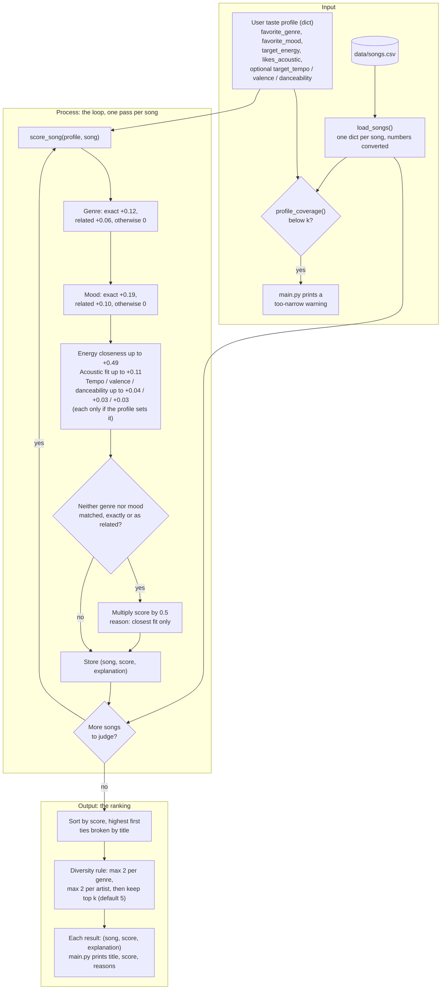

# 🎵 Music Recommender Simulation

## Project Summary

In this project you will build and explain a small music recommender system.

Your goal is to:

- Represent songs and a user "taste profile" as data
- Design a scoring rule that turns that data into recommendations
- Evaluate what your system gets right and wrong
- Reflect on how this mirrors real world AI recommenders

Replace this paragraph with your own summary of what your version does.

---

## How The System Works

Real-world recommenders like Spotify and YouTube Music combine two ideas. Collaborative filtering looks at what millions of other listeners played, skipped, saved, and repeated, and suggests songs that people with similar habits enjoyed. Content-based filtering looks at the songs themselves (genre, mood, tempo, energy, and so on) and finds ones similar to what you already like. Production systems blend these signals, add context such as time of day, and rank a huge catalog in stages.

My version is a small content-based recommender. It has no listening history from other users, only a 40-song catalog and one user's stated taste, so it can only compare songs to a profile.

**The plan**

1. **Input:** a taste profile (favorite genre, favorite mood, target energy, whether the user likes acoustic music, plus optional tempo, valence and danceability targets) and the song catalog loaded from `data/songs.csv`.
2. **Process:** loop over every song and give it a score from 0 to 1 by adding weighted points. Energy counts most (about 0.49), then mood (0.19), genre (0.12) and acoustic fit (0.11), with small optional tempo, valence and danceability terms (about 0.04, 0.03, 0.03). Energy and the other numeric features are scored by how *close* a song is to the target, not by whether it is higher or lower. Related genres and moods earn half credit, and songs that match neither genre nor mood are halved.
3. **Output:** sort by score, break ties by title, apply the diversity rule (at most 2 songs of one genre and 2 by one artist per list), and return the top `k` (default 5), each with a plain-language reason built from its point contributions. If a profile matches too few songs, a warning says the profile may be too narrow.

The data flow chart and the full scoring rules are below.

### Features used in the simulation

**`Song`** (one row of `data/songs.csv`)

| Feature | Type | Used in scoring? |
|---|---|---|
| `id`, `title`, `artist` | int / str | No, identification and display only (`title` breaks ties) |
| `genre` | str | Yes, exact match with the user's favorite genre (weight 0.12), half credit for a related genre |
| `mood` | str | Yes, exact match with the user's favorite mood (weight 0.19), half credit for a related mood |
| `energy` | float, 0-1 | Yes, Gaussian closeness to the user's target energy (weight 0.49) |
| `acousticness` | float, 0-1 | Yes, rewarded if the user likes acoustic, otherwise the inverse (weight 0.11) |
| `tempo_bpm`, `valence`, `danceability` | int / float | Yes, but only when the profile sets a target; small closeness terms (weights 0.04, 0.03, 0.03) |

**`UserProfile`**

| Feature | Type | Compared against |
|---|---|---|
| `favorite_genre` | str | `Song.genre` |
| `favorite_mood` | str | `Song.mood` |
| `target_energy` | float, 0-1 | `Song.energy` |
| `likes_acoustic` | bool | `Song.acousticness` |
| `target_tempo`, `target_valence`, `target_danceability` | optional float | `Song.tempo_bpm`, `Song.valence`, `Song.danceability` |

### Data Flow



### Algorithm Recipe

Every song in the catalog is scored against the user's profile with the same rules, then the songs are ranked. The weights sum to 1.0, so a score always falls between 0 and 1. The raw weights are written as genre 0.14, mood 0.22, energy 0.56, acoustic 0.12 and 0.04 / 0.03 / 0.03 for the small terms. That adds up to 1.28, so `recommender.py` divides each by 1.28, and the rounded values below are what each feature is actually worth. (Genre was halved and energy doubled from the original 0.28 / 0.22 / 0.28 / 0.12 recipe as a sensitivity experiment, see Experiment 3.) This is what `score_song()` in `src/recommender.py` implements.

In one line:

```
score = [genre (0.14) + mood (0.22) + energy (0.56) + acoustic (0.12) + tempo/valence/danceability (0.04 + 0.03 + 0.03)] / 1.28
        then x 0.5 if neither genre nor mood matched, exactly or as a related label
```

#### Step 1: Score each feature (points)

| Rule | Points |
|---|---|
| **Genre**: exact match with `favorite_genre` | +0.12 (0.14 / 1.28) |
| **Genre, related**: same family (pop / indie pop, rock / metal, lofi / ambient / jazz, folk / country / blues, edm / synthwave) | +0.06 (half credit) |
| **Mood**: exact match with `favorite_mood` | +0.19 (0.22 / 1.28) |
| **Mood, related**: same family (chill / relaxed / peaceful / laid-back / focused, intense / aggressive, happy / euphoric / festive, melancholy / sorrowful / nostalgic) | +0.10 (half credit) |
| **Energy closeness**: `0.49 × exp(-(energy - target_energy)² / (2 × 0.25²))` (0.56 / 1.28 = 0.49) | 0 to +0.49, full points at the target and fading smoothly in both directions |
| **Acoustic fit**: `0.11 × acousticness` if `likes_acoustic`, otherwise `0.11 × (1 - acousticness)` | 0 to +0.11 |
| **Tempo, valence, danceability closeness** (optional, only if the profile sets `target_tempo`, `target_valence`, `target_danceability`) | up to +0.04, +0.03, +0.03 (0.04 / 0.03 / 0.03 over 1.28, rounded) |

#### Step 2: Apply the penalty

If a song matches neither genre nor mood, not even as a related one, its total is multiplied by 0.5 and its explanation says "closest fit only". This keeps a song that is merely the right energy and texture from outranking real genre or mood matches, and tells the reader it is filler.

#### Step 3: Rank and return

Sort by score from highest to lowest and break ties alphabetically by title so results are reproducible. Then apply the **diversity rule**: walk down the ranked list and skip any song whose genre already has `max_per_genre` songs or whose artist already has `max_per_artist` songs in the list (`main.py` uses 2 and 2). Skipped songs are only used to backfill if fewer than `k` songs fit under the caps, and the final list is re-sorted best first. The caps are optional arguments of `recommend_songs()` and default to off. Return the top `k` (default 5). Each result carries the list of point contributions as its plain-language explanation.

#### Design choices

- Energy has by far the most weight (0.49), then mood (0.19), genre (0.12) and acousticness (0.11). This is the result of the weight-shift experiment: genre was halved and energy doubled, so the sound of a song now matters more than its label.
- Energy uses closeness to a target, not "higher is better", so a calm listener is not handed loud songs and an intense listener is not handed sleepy ones.
- Genre and mood are exact matches first, but related labels earn half credit. "Indie pop" is no longer worth nothing to a "pop" fan, and a jazz "relaxed" song can still reach a "chill lofi" listener.
- The tempo, valence and danceability terms are small. Their job is to separate songs that would otherwise tie, such as two penalized near-misses with the same energy.
- Different profiles get different results because only the profile changes. The "Chill Lofi" profile (lofi / chill / 0.40 energy / acoustic) and the "Intense Rock" profile (rock / intense / 0.92 energy / not acoustic) have no overlap in their top 3.
- `profile_coverage()` counts how many songs match a profile's genre or mood, exactly or as a relative. A low count means the profile is too narrow for the catalog, and `main.py` prints a warning. With the 40-song catalog none of the four built-in profiles trigger it (Intense Rock matches 9 songs), but a profile with an unknown genre and mood would.

**Worked example** (Chill Lofi profile, song "Coffee Shop Stories": jazz, relaxed, energy 0.37, acousticness 0.89, tempo 90, valence 0.71, danceability 0.54)

```
genre related (jazz ~ lofi)   +0.06
mood related (relaxed ~ chill) +0.10
energy        0.49 × exp(-(0.37 - 0.40)² / 0.125) = +0.49
acoustic fit  0.11 × 0.89                          = +0.09
tempo / valence / danceability                     = +0.08
total                                                0.82
```

Under the earlier all-or-nothing rules this song scored 0.22 (original weights). For comparison, "Library Rain" (lofi, chill) scores 0.97 and "Neon Pulse" (edm, euphoric, a poor fit) is penalized down to 0.04.

#### Expected biases

This is a hand-tuned system on a 40-song catalog, so I expect these biases and gaps:

- **It may still over-prioritize genre labels and ignore great mood matches.** Genre (0.12) is now worth less than mood (0.19), which narrowed the gap, but a song in the right genre with only a related mood can still edge out an exact mood match in another genre. In the Chill Lofi results, Focus Flow (lofi, related mood) scores 0.88 and still beats Spacewalk Thoughts (ambient, an exact "chill" match) at 0.86. With the original weights the gap was 0.86 vs 0.80.
- **Energy now dominates.** At about 0.49 of the score, a song with the right energy can climb the list on that alone. Bass Cathedral (EDM, energy 0.97) now reaches Intense Rock's top 5 and Highway Daydream (rock) reaches Pop Happy's, because they match the mood and energy even though the genre is wrong.
- **Genres and moods outside my "families" get no leniency.** I wrote the families by hand. Hip hop, classical, r&b, reggae and latin have no related genre, and "moody", "confident" and "romantic" have no related mood. Fans of those get all-or-nothing matching while pop, rock and lofi fans get partial credit.
- **The catalog favors some tastes.** There are 17 genres across 40 songs. Lofi has 6 songs, pop and rock have 5 each, and most other genres have 1 or 2, so lofi, pop and rock listeners get several exact matches while a reggae or latin listener's list is padded with penalized near-misses.
- **One favorite genre and one favorite mood.** A listener who likes both jazz and metal cannot be described, and the profile is stated, not learned, so it can be wrong or out of date.
- **Fixed, subjective weights.** The numbers are my judgment, not learned from listener behavior. Moving only about 0.02 of weight from genre to mood (0.10 genre, 0.22 mood) swaps Focus Flow and Spacewalk Thoughts in the Chill Lofi results, and the Experiment 3 shift changed one song in three of the four top 5s.
- **Closeness assumes a single sweet spot.** A listener who enjoys both very calm and very intense music would be scored poorly by a single target energy.
- **Tie-breaking is alphabetical.** When scores are exactly equal, songs earlier in the alphabet are shown first, which has nothing to do with quality.

**Quick answers**

- **What features does each `Song` use?** Genre, mood, energy and acousticness always; tempo, valence and danceability when the profile asks for them. `id`, `title` and `artist` are for display and tie-breaking only.
- **What does the `UserProfile` store?** A favorite genre, favorite mood, target energy, an acoustic preference, and optional tempo, valence and danceability targets.
- **How is a score computed?** Each song is scored against the profile with the same weighted rules in the Algorithm Recipe above, then halved if neither genre nor mood matches.
- **How are songs chosen?** All songs are scored, sorted highest first, and the top `k` are returned.

---

## Getting Started

### Setup

1. Create a virtual environment (optional but recommended):

   ```bash
   python -m venv .venv
   source .venv/bin/activate      # Mac or Linux
   .venv\Scripts\activate         # Windows

2. Install dependencies

```bash
pip install -r requirements.txt
```

3. Run the app:

```bash
python -m src.main
```

### Running Tests

Run the starter tests with:

```bash
pytest
```

You can add more tests in `tests/test_recommender.py`.

---

## Sample Recommendation Output

This is the terminal output of `python -m src.main`, which runs four profiles against the 40-song catalog and shows the top 5 for each with their scores and reasons. The diversity rule (at most 2 songs per genre and 2 per artist) is on. Each profile's output is shown in its own block below.

### Chill Lofi

```
================================================================
  Chill Lofi: lofi / chill / energy 0.40 / acoustic
================================================================

1. Library Rain  (by Paper Lanterns)
   Score 0.97  [###################.]
   Why:
     - genre match (lofi) +0.12
     - mood match (chill) +0.19
     - energy 0.35 vs target 0.40 +0.48
     - acoustic fit +0.09
     - tempo 72 vs target 78 +0.03
     - valence 0.6 vs target 0.58 +0.03
     - danceability 0.58 vs target 0.6 +0.03

2. Midnight Coding  (by LoRoom)
   Score 0.97  [###################.]
   Why:
     - genre match (lofi) +0.12
     - mood match (chill) +0.19
     - energy 0.42 vs target 0.40 +0.49
     - acoustic fit +0.07
     - tempo 78 vs target 78 +0.04
     - valence 0.56 vs target 0.58 +0.03
     - danceability 0.62 vs target 0.6 +0.03

3. Spacewalk Thoughts  (by Orbit Bloom)
   Score 0.86  [#################...]
   Why:
     - related genre (ambient ~ lofi) +0.06
     - mood match (chill) +0.19
     - energy 0.28 vs target 0.40 +0.44
     - acoustic fit +0.10
     - tempo 60 vs target 78 +0.03
     - valence 0.65 vs target 0.58 +0.03
     - danceability 0.41 vs target 0.6 +0.02

4. Coffee Shop Stories  (by Slow Stereo)
   Score 0.82  [################....]
   Why:
     - related genre (jazz ~ lofi) +0.06
     - related mood (relaxed ~ chill) +0.10
     - energy 0.37 vs target 0.40 +0.49
     - acoustic fit +0.09
     - tempo 90 vs target 78 +0.03
     - valence 0.71 vs target 0.58 +0.02
     - danceability 0.54 vs target 0.6 +0.03

5. Midnight Blue Room  (by Satin Rae)
   Score 0.72  [##############......]
   Why:
     - related genre (jazz ~ lofi) +0.06
     - energy 0.40 vs target 0.40 +0.49
     - acoustic fit +0.09
     - tempo 96 vs target 78 +0.03
     - valence 0.5 vs target 0.58 +0.03
     - danceability 0.5 vs target 0.6 +0.02
```

### Intense Rock

```
================================================================
  Intense Rock: rock / intense / energy 0.92 / not acoustic
================================================================

1. Storm Runner  (by Voltline)
   Score 0.99  [####################]
   Why:
     - genre match (rock) +0.12
     - mood match (intense) +0.19
     - energy 0.91 vs target 0.92 +0.49
     - acoustic fit +0.09
     - tempo 152 vs target 155 +0.03
     - valence 0.48 vs target 0.45 +0.03
     - danceability 0.66 vs target 0.65 +0.03

2. Thunder Alley  (by Rust Valley)
   Score 0.98  [####################]
   Why:
     - genre match (rock) +0.12
     - mood match (intense) +0.19
     - energy 0.89 vs target 0.92 +0.49
     - acoustic fit +0.09
     - tempo 148 vs target 155 +0.03
     - valence 0.52 vs target 0.45 +0.03
     - danceability 0.6 vs target 0.65 +0.03

3. Forged in Ash  (by Grave Anthem)
   Score 0.90  [##################..]
   Why:
     - related genre (metal ~ rock) +0.06
     - mood match (intense) +0.19
     - energy 0.96 vs target 0.92 +0.48
     - acoustic fit +0.10
     - tempo 172 vs target 155 +0.03
     - valence 0.25 vs target 0.45 +0.02
     - danceability 0.4 vs target 0.65 +0.02

4. Bass Cathedral  (by Circuit Bloom)
   Score 0.85  [#################...]
   Why:
     - mood match (intense) +0.19
     - energy 0.97 vs target 0.92 +0.48
     - acoustic fit +0.10
     - tempo 140 vs target 155 +0.03
     - valence 0.62 vs target 0.45 +0.02
     - danceability 0.82 vs target 0.65 +0.02

5. Gym Hero  (by Max Pulse)
   Score 0.84  [#################...]
   Why:
     - mood match (intense) +0.19
     - energy 0.93 vs target 0.92 +0.49
     - acoustic fit +0.10
     - tempo 132 vs target 155 +0.02
     - valence 0.77 vs target 0.45 +0.01
     - danceability 0.88 vs target 0.65 +0.02
```

### High-Energy Pop

```
================================================================
  High-Energy Pop: pop / happy / energy 0.88 / not acoustic
================================================================

1. Sunrise City  (by Neon Echo)
   Score 0.96  [###################.]
   Why:
     - genre match (pop) +0.12
     - mood match (happy) +0.19
     - energy 0.82 vs target 0.88 +0.48
     - acoustic fit +0.09
     - tempo 118 vs target 125 +0.03
     - valence 0.84 vs target 0.85 +0.03
     - danceability 0.79 vs target 0.85 +0.03

2. Dancefloor Mirage  (by Neon Echo)
   Score 0.89  [##################..]
   Why:
     - genre match (pop) +0.12
     - related mood (euphoric ~ happy) +0.10
     - energy 0.90 vs target 0.88 +0.49
     - acoustic fit +0.10
     - tempo 126 vs target 125 +0.04
     - valence 0.86 vs target 0.85 +0.03
     - danceability 0.89 vs target 0.85 +0.03

3. Rooftop Lights  (by Indigo Parade)
   Score 0.85  [#################...]
   Why:
     - related genre (indie pop ~ pop) +0.06
     - mood match (happy) +0.19
     - energy 0.76 vs target 0.88 +0.44
     - acoustic fit +0.07
     - tempo 124 vs target 125 +0.04
     - valence 0.81 vs target 0.85 +0.03
     - danceability 0.82 vs target 0.85 +0.03

4. Block Party Sunday  (by Block Theory)
   Score 0.83  [#################...]
   Why:
     - mood match (happy) +0.19
     - energy 0.82 vs target 0.88 +0.48
     - acoustic fit +0.09
     - tempo 98 vs target 125 +0.02
     - valence 0.85 vs target 0.85 +0.03
     - danceability 0.9 vs target 0.85 +0.03

5. Neon Pulse  (by Circuit Bloom)
   Score 0.76  [###############.....]
   Why:
     - related mood (euphoric ~ happy) +0.10
     - energy 0.94 vs target 0.88 +0.48
     - acoustic fit +0.10
     - tempo 128 vs target 125 +0.03
     - valence 0.88 vs target 0.85 +0.03
     - danceability 0.9 vs target 0.85 +0.03
```

### Pop Happy

```
================================================================
  Pop Happy: pop / happy / energy 0.80
================================================================

1. Sunrise City  (by Neon Echo)
   Score 0.81  [################....]
   Why:
     - genre match (pop) +0.12
     - mood match (happy) +0.19
     - energy 0.82 vs target 0.80 +0.49

2. Rooftop Lights  (by Indigo Parade)
   Score 0.74  [###############.....]
   Why:
     - related genre (indie pop ~ pop) +0.06
     - mood match (happy) +0.19
     - energy 0.76 vs target 0.80 +0.48

3. Block Party Sunday  (by Block Theory)
   Score 0.68  [##############......]
   Why:
     - mood match (happy) +0.19
     - energy 0.82 vs target 0.80 +0.49

4. Dancefloor Mirage  (by Neon Echo)
   Score 0.67  [#############.......]
   Why:
     - genre match (pop) +0.12
     - related mood (euphoric ~ happy) +0.10
     - energy 0.90 vs target 0.80 +0.45

5. Highway Daydream  (by Desert Static)
   Score 0.66  [#############.......]
   Why:
     - mood match (happy) +0.19
     - energy 0.72 vs target 0.80 +0.47
```

**Screenshot or video** *(optional)*: <!-- Insert a screenshot or demo video link here -->

---

## Experiments You Tried

### Experiment 1: Do the results match my musical intuition?

I compared the top 5 for two profiles against what I would expect to hear, using the original weights (genre 0.28, mood 0.22, energy 0.28). I can't listen to the songs, so this judgment comes from their labels and numbers (genre, mood, energy, acousticness).

#### Chill Lofi: mostly feels right

- Library Rain and Midnight Coding at #1 and #2 are exactly what I would pick: lofi, chill, low energy and acoustic.
- Focus Flow and Study Hall Static are good study music, so "focused" is a fair stand-in for "chill".
- **Miss:** Moonlit Sonata (classical, energy 0.18, acousticness 0.97) and Spacewalk Thoughts (ambient, an exact chill match, energy 0.28) are the calmest songs in the catalog. Spacewalk Thoughts only reaches #6 (0.80) because lofi songs with a merely related mood outrank it. A real chill listener would likely want both near the top.

#### High-Energy Pop: top 3 feel right, the rest less so

- Sunrise City, Dancefloor Mirage and Rooftop Lights are bright, danceable and upbeat, which suits a party listener.
- Gym Hero at #4 is defensible (pop, matching energy), but its mood is "intense" (workout music), not happy.
- **Miss:** Neon Pulse (EDM, euphoric, energy 0.94, danceability 0.90) is missing. It loses to Block Party Sunday only because "happy" is an exact mood match while "euphoric" gets half credit, and the system has no idea that EDM and pop are close.
- Block Party Sunday at #5 is hip hop at 98 BPM against a 125 BPM target. It gets in on mood and energy alone, so it feels random.

**Takeaway:** The model separates very different tastes well (Chill Lofi and Intense Rock share no songs) and orders obvious matches sensibly. It does worst at cross-genre vibe matches, where the feel is right but the genre label differs. These misses are real cases of the genre-over-mood bias listed under "Expected biases".

#### Ideas I have not tried yet

- Add a dance-music genre family (pop / edm / latin) so Neon Pulse gets partial genre credit.
- Give mood more weight relative to genre, or give related labels more than half credit (Experiment 3 does part of this by halving genre).
- Raise the tempo weight (currently about 0.04) so a 98 BPM song is penalized more against a 125 BPM target.

### Experiment 2: Growing the catalog from 20 to 40 songs

This experiment used the original weights. Adding 20 songs fixed a gap in the results. With 20 songs, Intense Rock had only 3 genre or mood matches, so its #4 and #5 were fallbacks scoring 0.22 and 0.20, and the "too narrow" warning appeared. With 40 songs it has 9 matches and a top 5 scoring from 0.99 down to 0.72, with no warning. More songs per genre made the rankings more meaningful, but they also made the genre bias more visible: Chill Lofi's top 5 became all lofi.

### Experiment 3: Weight shift (genre halved, energy doubled)

I changed the raw weights from genre 0.28 / energy 0.28 to genre 0.14 / energy 0.56. That adds 0.14 to the total (1.28), so `recommender.py` divides every weight by 1.28 to keep the sum at exactly 1.0. The effective weights became genre 0.12, mood 0.19, energy 0.49, acoustic 0.11, and 0.04 / 0.03 / 0.03 for the small terms. This is now the system's default.

| Profile | Entered the top 5 | Left | Reordering |
|---|---|---|---|
| Chill Lofi | Spacewalk Thoughts | Sleepy Vinyl | none in the top 4 |
| Intense Rock | Bass Cathedral (EDM) | Iron Cathedral | Forged in Ash now above Broken Amplifier |
| High-Energy Pop | none | none | Block Party Sunday and Gym Hero swap (#4 and #5) |
| Pop Happy | Highway Daydream (rock, happy) | Gym Hero | Rooftop Lights now above Dancefloor Mirage |

**Math check:** the weights sum to 1.0, every score across all 4 profiles and 40 songs stays between 0.01 and 0.99, and a song that hits every target of the Chill Lofi profile scores exactly 1.0.

**What it showed**

- The system is moderately sensitive, not fragile. The #1 pick is the same for every profile, and at most one song enters or leaves each top 5.
- The changes happen at ranks 4 and 5, where genre had been the tie-breaker.
- Some changes look better: Spacewalk Thoughts, the calm exact-chill match I flagged in Experiment 1, now makes the Chill Lofi top 5, and Gym Hero (workout pop) drops out of Pop Happy.
- Some look worse: Bass Cathedral (EDM) joins Intense Rock and Highway Daydream (rock) joins Pop Happy purely on energy and mood. Less genre weight means less protection against cross-genre matches.

### Experiment 4: Diversity rule (max 2 per genre, max 2 per artist)

To answer the filter-bubble question, `recommend_songs()` now takes optional `max_per_genre` and `max_per_artist` caps, and `main.py` uses 2 and 2. Ranking is unchanged until a song would exceed a cap, and then the next-best song that fits takes its place.

| Profile | Distinct genres in top 5 (before to after) | Distinct artists (before to after) | Average score (before to after) | What changed |
|---|---|---|---|---|
| Chill Lofi | 2 to 3 | 3 to 5 | 0.91 to 0.87 | Focus Flow and Study Hall Static (third and fourth lofi songs) replaced by Coffee Shop Stories (jazz) and Midnight Blue Room (jazz) |
| Intense Rock | 3 to 4 | 5 to 5 | 0.92 to 0.91 | Third rock song Broken Amplifier replaced by Gym Hero |
| High-Energy Pop | 3 to 4 | 4 to 4 | 0.87 to 0.86 | Gym Hero replaced by Neon Pulse |
| Pop Happy | 4 to 4 | 4 to 4 | 0.71 to 0.71 | none |

**What it showed:** the cap widens the lists at a small cost, since the average score drops by 0.01-0.04. Chill Lofi gains the most variety, and it is also where the cost is highest: Midnight Blue Room (jazz, moody, 0.72) is a noticeably weaker match than the lofi songs it displaced. Pop Happy is unchanged because its list never hit a cap (only two pop songs and no repeated artist beyond two). The rule fixes lists that are too samey, but it cannot fix the shortage of songs in thin genres, so it does not replace adding more songs. This also means the system's scores are no longer a pure ranking: a song can be skipped even though it scores higher than one that is shown.

---

## Limitations and Risks

- It only works on a small catalog (40 songs), so many profiles run out of real matches.
- It does not understand lyrics, language, artist similarity or listening history.
- It can over-favor genre and the genres that have more songs in the catalog (see "Expected biases" above).
- Genre and mood families are hand-written, so labels I did not group get no partial credit.

You will go deeper on this in your model card.

---

## Reflection

Read and complete `model_card.md`:

[**Model Card**](model_card.md)

Write 1 to 2 paragraphs here about what you learned:

- about how recommenders turn data into predictions
- about where bias or unfairness could show up in systems like this
