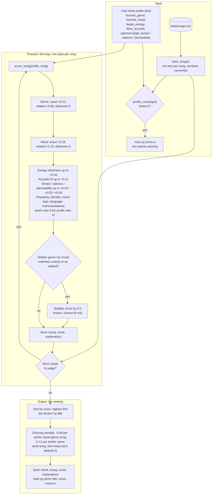

# 🎵 Music Recommender Simulation

## Project Summary

In this project you will build and explain a small music recommender system.

Your goal is to:

- Represent songs and a user "taste profile" as data
- Design a scoring rule that turns that data into recommendations
- Evaluate what your system gets right and wrong
- Reflect on how this mirrors real world AI recommenders

Replace this paragraph with your own summary of what your version does.

---

## How The System Works

Real-world recommenders like Spotify and YouTube Music combine two ideas. Collaborative filtering looks at what millions of other listeners played, skipped, saved, and repeated, and suggests songs that people with similar habits enjoyed. Content-based filtering looks at the songs themselves (genre, mood, tempo, energy, and so on) and finds ones similar to what you already like. Production systems blend these signals, add context such as time of day, and rank a huge catalog in stages.

My version is a small content-based recommender. It has no listening history from other users, only a 40-song catalog and one user's stated taste, so it can only compare songs to a profile.

**The plan**

1. **Input:** a taste profile (favorite genre, favorite mood, target energy, whether the user likes acoustic music, plus optional tempo, valence, danceability, popularity, release decade, detailed mood tag, language and instrumentalness preferences) and the song catalog loaded from `data/songs.csv`.
2. **Process:** loop over every song and give it a score from 0 to 1 by adding weighted points. Energy counts most (about 0.49), then mood (0.19), genre (0.12) and acoustic fit (0.11), with small optional tempo, valence and danceability terms (about 0.04, 0.03, 0.03) and five more optional terms for the extra attributes (popularity, decade, mood tags, language, instrumentalness). Energy and the other numeric features are scored by how *close* a song is to the target, not by whether it is higher or lower. Related genres and moods earn half credit, and songs that match neither genre nor mood are halved.
3. **Output:** sort by score, break ties by title, apply the diversity penalty (a song loses 0.08 for each earlier song of its genre and 0.12 for each earlier song by its artist), and return the top `k` (default 5), each with a plain-language reason built from its point contributions. If a profile matches too few songs, a warning says the profile may be too narrow.

The data flow chart and the full scoring rules are below.

### Features used in the simulation

**`Song`** (one row of `data/songs.csv`)

| Feature | Type | Used in scoring? |
|---|---|---|
| `id`, `title`, `artist` | int / str | No, identification and display only (`title` breaks ties) |
| `genre` | str | Yes, exact match with the user's favorite genre (weight 0.12), half credit for a related genre |
| `mood` | str | Yes, exact match with the user's favorite mood (weight 0.19), half credit for a related mood |
| `energy` | float, 0-1 | Yes, Gaussian closeness to the user's target energy (weight 0.49) |
| `acousticness` | float, 0-1 | Yes, rewarded if the user likes acoustic, otherwise the inverse (weight 0.11) |
| `tempo_bpm`, `valence`, `danceability` | int / float | Yes, but only when the profile sets a target; small closeness terms (weights 0.04, 0.03, 0.03) |
| `popularity` | int, 0-100 | Yes, only when the profile sets `target_popularity`; closeness (weight 0.03 before rescaling) |
| `release_decade` | int, e.g. 1990, 2010 | Yes, only when the profile sets `preferred_decade`; closeness in years (weight 0.03) |
| `mood_tags` | list of str, e.g. `nostalgic;neon;late-night` in the CSV | Yes, only when the profile sets `favorite_mood_tags`; share of the wanted tags the song has (weight 0.05) |
| `language` | str, e.g. `english`, `spanish`, `instrumental` | Yes, only when the profile sets `preferred_language`; exact match (weight 0.02) |
| `instrumentalness` | float, 0-1 | Yes, only when the profile sets `target_instrumentalness`; closeness (weight 0.03) |

**`UserProfile`**

| Feature | Type | Compared against |
|---|---|---|
| `favorite_genre` | str | `Song.genre` |
| `favorite_mood` | str | `Song.mood` |
| `target_energy` | float, 0-1 | `Song.energy` |
| `likes_acoustic` | bool | `Song.acousticness` |
| `target_tempo`, `target_valence`, `target_danceability` | optional float | `Song.tempo_bpm`, `Song.valence`, `Song.danceability` |
| `target_popularity` | optional float, 0-100 | `Song.popularity` |
| `preferred_decade` | optional int | `Song.release_decade` |
| `favorite_mood_tags` | optional list of str | `Song.mood_tags` |
| `preferred_language` | optional str | `Song.language` |
| `target_instrumentalness` | optional float, 0-1 | `Song.instrumentalness` |

### Data Flow



### Algorithm Recipe

Every song in the catalog is scored against the user's profile with the same rules, then the songs are ranked. The weights sum to 1.0, so a score always falls between 0 and 1. The raw weights are written as genre 0.14, mood 0.22, energy 0.56, acoustic 0.12 and 0.04 / 0.03 / 0.03 for the small terms. That adds up to 1.28, so `recommender.py` divides each by 1.28, and the rounded values below are what each feature is actually worth. (Genre was halved and energy doubled from the original 0.28 / 0.22 / 0.28 / 0.12 recipe as a sensitivity experiment, see Experiment 3.) This is what `score_song()` in `src/recommender.py` implements.

In one line:

```
score = [genre (0.14) + mood (0.22) + energy (0.56) + acoustic (0.12) + tempo/valence/danceability (0.04 + 0.03 + 0.03)] / 1.28
        then x 0.5 if neither genre nor mood matched, exactly or as a related label
```

#### Step 1: Score each feature (points)

| Rule | Points |
|---|---|
| **Genre**: exact match with `favorite_genre` | +0.12 (0.14 / 1.28) |
| **Genre, related**: same family (pop / indie pop, rock / metal, lofi / ambient / jazz, folk / country / blues, edm / synthwave) | +0.06 (half credit) |
| **Mood**: exact match with `favorite_mood` | +0.19 (0.22 / 1.28) |
| **Mood, related**: same family (chill / relaxed / peaceful / laid-back / focused, intense / aggressive, happy / euphoric / festive, melancholy / sorrowful / nostalgic) | +0.10 (half credit) |
| **Energy closeness**: `0.49 × exp(-(energy - target_energy)² / (2 × 0.25²))` (0.56 / 1.28 = 0.49) | 0 to +0.49, full points at the target and fading smoothly in both directions |
| **Acoustic fit**: `0.11 × acousticness` if `likes_acoustic`, otherwise `0.11 × (1 - acousticness)` | 0 to +0.11 |
| **Tempo, valence, danceability closeness** (optional, only if the profile sets `target_tempo`, `target_valence`, `target_danceability`) | up to +0.04, +0.03, +0.03 (0.04 / 0.03 / 0.03 over 1.28, rounded) |
| **Popularity closeness** (optional, `target_popularity`): `exp(-(popularity - target)² / (2 × 25²))` | up to +0.03 |
| **Release decade closeness** (optional, `preferred_decade`): `exp(-(decade - preferred)² / (2 × 10²))`, so one decade away keeps about 0.6 and two decades about 0.14 | up to +0.03 |
| **Detailed mood tags** (optional, `favorite_mood_tags`): share of the wanted tags the song has, ignoring case | up to +0.05 |
| **Language** (optional, `preferred_language`): 1 if it matches, 0 if not | up to +0.02 |
| **Instrumentalness closeness** (optional, `target_instrumentalness`): `exp(-(value - target)² / (2 × 0.25²))` | up to +0.03 |

#### Step 1b: Keep the total at 1.0 when extras are on

The five extra terms have raw weights 0.03, 0.03, 0.05, 0.02 and 0.03 (0.16 in total). For a profile that sets some of them, `weights_for()` adds the active ones and divides **every** weight by `1 + (their total)`. A profile that sets all five divides by 1.16, so the weights still sum to exactly 1 and scores stay between 0 and 1. A profile that sets none of them divides by 1, so it is scored exactly as before. A song that is missing one of the attributes earns 0 for that term and the score never goes above 1.

#### Step 2: Apply the penalty

If a song matches neither genre nor mood, not even as a related one, its total is multiplied by 0.5 and its explanation says "closest fit only". This keeps a song that is merely the right energy and texture from outranking real genre or mood matches, and tells the reader it is filler.

#### Step 3: Rank and return

Sort by score from highest to lowest and break ties alphabetically by title so results are reproducible. Then apply the **diversity penalty**: pick songs one at a time, and before each pick take `genre_penalty` (0.08) off a candidate's score for every song of its genre already picked and `artist_penalty` (0.12) off for every song by its artist already picked. The best penalized song is picked next, so a weaker song from a new artist can overtake a strong repeat, while a much stronger song can still repeat. The score shown is the penalized one (never below 0), and the explanation adds a line such as `diversity penalty -0.12 (1 earlier by Neon Echo)`. Both penalties default to 0 in `recommend_songs()`, so the rule is off unless asked for. A hard cap (`max_per_genre`, `max_per_artist`) is also available, and `main.py` can switch between them with `--diversity` (see Getting Started). Return the top `k` (default 5). Each result carries the list of point contributions as its plain-language explanation.

#### Ranking strategies (switchable modes)

The scoring rules stay the same in every mode. A mode only changes how much each feature is worth. Each one is rescaled to sum to 1.0, so scores always stay between 0 and 1.

| Mode | Genre | Mood | Energy | Acoustic | Tempo / valence / danceability | Use it when |
|---|---|---|---|---|---|---|
| `balanced` (default) | 0.12 | 0.19 | 0.49 | 0.11 | 0.04 / 0.03 / 0.03 | you want a mix, with the sound counting most |
| `genre-first` | 0.45 | 0.15 | 0.20 | 0.10 | 0.04 / 0.03 / 0.03 | you want to stay inside the genre you named |
| `mood-first` | 0.11 | 0.47 | 0.21 | 0.11 | 0.04 / 0.03 / 0.03 | you want the feeling to follow you across genres |
| `energy-focused` | 0.08 | 0.10 | 0.62 | 0.10 | 0.04 / 0.03 / 0.03 | you care how loud or calm it is more than the labels |

The mode is a `strategy` argument on `score_song()` and `recommend_songs()` in `src/recommender.py`, and a `--strategy` flag on the command line (see Getting Started). Profiles that set the extra attributes still divide by `1 + (the active extras)`, so the weights still sum to 1 in every mode.

#### How the code is organized (Strategy pattern)

`src/recommender.py` keeps each concern in its own piece, so adding something new does not mean editing a long function:

- **Feature scorers.** Each feature (genre, mood, energy, acoustic, tempo, valence, danceability, popularity, decade, mood tags, language, instrumentalness) has a small scorer object with the same two methods, `applies()` and `score()`. The list `SCORERS` holds them and `score_song()` loops over it. To add a feature, write a scorer, append it to `SCORERS` and give it a weight.
- **The no-match penalty** is its own step (`apply_no_match_penalty`), applied after all scorers have run.
- **Re-rankers.** The variety rules run after ranking: `DiversityPenaltyReranker` (soft, the default in `main.py`) and `DiversityReranker` (hard cap). `recommend_songs(..., rerankers=[...])` accepts others.
- **Ranking modes** are named sets of weights (see above).

Because `applies()` is the single place that decides whether a preference counts, a blank preference such as `preferred_language="  "` no longer reserves weight it cannot use.

#### Design choices

- Energy has by far the most weight (0.49), then mood (0.19), genre (0.12) and acousticness (0.11). This is the result of the weight-shift experiment: genre was halved and energy doubled, so the sound of a song now matters more than its label.
- Energy uses closeness to a target, not "higher is better", so a calm listener is not handed loud songs and an intense listener is not handed sleepy ones.
- Genre and mood are exact matches first, but related labels earn half credit. "Indie pop" is no longer worth nothing to a "pop" fan, and a jazz "relaxed" song can still reach a "chill lofi" listener.
- The tempo, valence and danceability terms are small. Their job is to separate songs that would otherwise tie, such as two penalized near-misses with the same energy.
- Different profiles get different results because only the profile changes. The "Chill Lofi" profile (lofi / chill / 0.40 energy / acoustic) and the "Intense Rock" profile (rock / intense / 0.92 energy / not acoustic) have no overlap in their top 3.
- `profile_coverage()` counts how many songs match a profile's genre or mood, exactly or as a relative. A low count means the profile is too narrow for the catalog, and `main.py` prints a warning. With the 40-song catalog none of the five built-in profiles trigger it (Intense Rock matches 9 songs), but a profile with an unknown genre and mood would.

**Worked example** (Chill Lofi profile, song "Coffee Shop Stories": jazz, relaxed, energy 0.37, acousticness 0.89, tempo 90, valence 0.71, danceability 0.54)

```
genre related (jazz ~ lofi)   +0.06
mood related (relaxed ~ chill) +0.10
energy        0.49 × exp(-(0.37 - 0.40)² / 0.125) = +0.49
acoustic fit  0.11 × 0.89                          = +0.09
tempo / valence / danceability                     = +0.08
total                                                0.82
```

Under the earlier all-or-nothing rules this song scored 0.22 (original weights). For comparison, "Library Rain" (lofi, chill) scores 0.97 and "Neon Pulse" (edm, euphoric, a poor fit) is penalized down to 0.04.

#### Expected biases

This is a hand-tuned system on a 40-song catalog, so I expect these biases and gaps:

- **It may still over-prioritize genre labels and ignore great mood matches.** Genre (0.12) is now worth less than mood (0.19), which narrowed the gap, but a song in the right genre with only a related mood can still edge out an exact mood match in another genre. In the Chill Lofi results, Focus Flow (lofi, related mood) scores 0.88 and still beats Spacewalk Thoughts (ambient, an exact "chill" match) at 0.86. With the original weights the gap was 0.86 vs 0.80.
- **Energy now dominates.** At about 0.49 of the score, a song with the right energy can climb the list on that alone. Bass Cathedral (EDM, energy 0.97) now reaches Intense Rock's top 5 and Highway Daydream (rock) reaches Pop Happy's, because they match the mood and energy even though the genre is wrong.
- **Genres and moods outside my "families" get no leniency.** I wrote the families by hand. Hip hop, classical, r&b, reggae and latin have no related genre, and "moody", "confident" and "romantic" have no related mood. Fans of those get all-or-nothing matching while pop, rock and lofi fans get partial credit.
- **The catalog favors some tastes.** There are 17 genres across 40 songs. Lofi has 6 songs, pop and rock have 5 each, and most other genres have 1 or 2, so lofi, pop and rock listeners get several exact matches while a reggae or latin listener's list is padded with penalized near-misses.
- **One favorite genre and one favorite mood.** A listener who likes both jazz and metal cannot be described, and the profile is stated, not learned, so it can be wrong or out of date.
- **Fixed, subjective weights.** The numbers are my judgment, not learned from listener behavior. Moving only about 0.02 of weight from genre to mood (0.10 genre, 0.22 mood) swaps Focus Flow and Spacewalk Thoughts in the Chill Lofi results, and the Experiment 3 shift changed one song in three of the four top 5s.
- **Closeness assumes a single sweet spot.** A listener who enjoys both very calm and very intense music would be scored poorly by a single target energy.
- **Tie-breaking is alphabetical.** When scores are exactly equal, songs earlier in the alphabet are shown first, which has nothing to do with quality.

**Quick answers**

- **What features does each `Song` use?** Genre, mood, energy and acousticness always; tempo, valence and danceability when the profile asks for them. `id`, `title` and `artist` are for display and tie-breaking only.
- **What does the `UserProfile` store?** A favorite genre, favorite mood, target energy, an acoustic preference, and optional tempo, valence and danceability targets.
- **How is a score computed?** Each song is scored against the profile with the same weighted rules in the Algorithm Recipe above, then halved if neither genre nor mood matches.
- **How are songs chosen?** All songs are scored, sorted highest first, and the top `k` are returned.

---

## Getting Started

### Setup

1. Create a virtual environment (optional but recommended):

   ```bash
   python -m venv .venv
   source .venv/bin/activate      # Mac or Linux
   .venv\Scripts\activate         # Windows

2. Install dependencies

```bash
pip install -r requirements.txt
```

3. Run the app:

```bash
python -m src.main
```

4. Switch the ranking mode (optional):

```bash
python -m src.main --list-strategies            # describe the modes
python -m src.main --strategy genre-first       # or mood-first, energy-focused, balanced (default)
python -m src.main --compare                    # top 5 titles under every mode, side by side
python -m src.main --diversity artist           # penalize a repeated artist only (or penalty, cap, off)
python -m src.main --format detailed            # the older bullet-list layout instead of the table
python -m src.main --adversarial                # also run the edge-case profiles (combine with --strategy)
```

### Running Tests

Run the starter tests with:

```bash
pytest
```

You can add more tests in `tests/test_recommender.py`.

---

## Sample Recommendation Output

This is the terminal output of `python -m src.main`, which runs five profiles against the 40-song catalog and shows the top 5 for each as a table: rank, title, artist, score, and one line per reason behind the score, with a one-line summary (average score, genres and artists) under each table. A score below 0.40 is marked `weak`. The diversity penalty (-0.08 per earlier song of the same genre, -0.12 per earlier song by the same artist) is on, so a repeated genre or artist shows a `diversity penalty` line in its reasons. Each profile's output is shown in its own block below.

### Chill Lofi

```
================================================================
  Chill Lofi: lofi / chill / energy 0.40 / acoustic
================================================================

+----+---------------------+-----------------+--------+------------------------------------------------------+
| #  | Title               | Artist          | Score  | Why (reasons)                                        |
+----+---------------------+-----------------+--------+------------------------------------------------------+
| 1  | Library Rain        | Paper Lanterns  | 0.97   | - genre match (lofi) +0.12                           |
|    |                     |                 |        | - mood match (chill) +0.19                           |
|    |                     |                 |        | - energy 0.35 vs target 0.40 +0.48                   |
|    |                     |                 |        | - acoustic fit +0.09                                 |
|    |                     |                 |        | - tempo 72 vs target 78 +0.03                        |
|    |                     |                 |        | - valence 0.6 vs target 0.58 +0.03                   |
|    |                     |                 |        | - danceability 0.58 vs target 0.6 +0.03              |
+----+---------------------+-----------------+--------+------------------------------------------------------+
| 2  | Midnight Coding     | LoRoom          | 0.89   | - genre match (lofi) +0.12                           |
|    |                     |                 |        | - mood match (chill) +0.19                           |
|    |                     |                 |        | - energy 0.42 vs target 0.40 +0.49                   |
|    |                     |                 |        | - acoustic fit +0.07                                 |
|    |                     |                 |        | - tempo 78 vs target 78 +0.04                        |
|    |                     |                 |        | - valence 0.56 vs target 0.58 +0.03                  |
|    |                     |                 |        | - danceability 0.62 vs target 0.6 +0.03              |
|    |                     |                 |        | - diversity penalty -0.08 (1 earlier lofi song)      |
+----+---------------------+-----------------+--------+------------------------------------------------------+
| 3  | Spacewalk Thoughts  | Orbit Bloom     | 0.86   | - related genre (ambient ~ lofi) +0.06               |
|    |                     |                 |        | - mood match (chill) +0.19                           |
|    |                     |                 |        | - energy 0.28 vs target 0.40 +0.44                   |
|    |                     |                 |        | - acoustic fit +0.10                                 |
|    |                     |                 |        | - tempo 60 vs target 78 +0.03                        |
|    |                     |                 |        | - valence 0.65 vs target 0.58 +0.03                  |
|    |                     |                 |        | - danceability 0.41 vs target 0.6 +0.02              |
+----+---------------------+-----------------+--------+------------------------------------------------------+
| 4  | Coffee Shop Stories | Slow Stereo     | 0.82   | - related genre (jazz ~ lofi) +0.06                  |
|    |                     |                 |        | - related mood (relaxed ~ chill) +0.10               |
|    |                     |                 |        | - energy 0.37 vs target 0.40 +0.49                   |
|    |                     |                 |        | - acoustic fit +0.09                                 |
|    |                     |                 |        | - tempo 90 vs target 78 +0.03                        |
|    |                     |                 |        | - valence 0.71 vs target 0.58 +0.02                  |
|    |                     |                 |        | - danceability 0.54 vs target 0.6 +0.03              |
+----+---------------------+-----------------+--------+------------------------------------------------------+
| 5  | Morning Porch Song  | Wren and Moss   | 0.71   | - related mood (peaceful ~ chill) +0.10              |
|    |                     |                 |        | - energy 0.28 vs target 0.40 +0.44                   |
|    |                     |                 |        | - acoustic fit +0.10                                 |
|    |                     |                 |        | - tempo 84 vs target 78 +0.03                        |
|    |                     |                 |        | - valence 0.62 vs target 0.58 +0.03                  |
|    |                     |                 |        | - danceability 0.45 vs target 0.6 +0.02              |
+----+---------------------+-----------------+--------+------------------------------------------------------+
Summary: average score 0.85 | 4 genres (lofi, ambient, jazz, folk) | 5 artists
```

### Intense Rock

```
================================================================
  Intense Rock: rock / intense / energy 0.92 / not acoustic
================================================================

+----+---------------------+-----------------+--------+------------------------------------------------------+
| #  | Title               | Artist          | Score  | Why (reasons)                                        |
+----+---------------------+-----------------+--------+------------------------------------------------------+
| 1  | Storm Runner        | Voltline        | 0.99   | - genre match (rock) +0.12                           |
|    |                     |                 |        | - mood match (intense) +0.19                         |
|    |                     |                 |        | - energy 0.91 vs target 0.92 +0.49                   |
|    |                     |                 |        | - acoustic fit +0.09                                 |
|    |                     |                 |        | - tempo 152 vs target 155 +0.03                      |
|    |                     |                 |        | - valence 0.48 vs target 0.45 +0.03                  |
|    |                     |                 |        | - danceability 0.66 vs target 0.65 +0.03             |
+----+---------------------+-----------------+--------+------------------------------------------------------+
| 2  | Forged in Ash       | Grave Anthem    | 0.90   | - related genre (metal ~ rock) +0.06                 |
|    |                     |                 |        | - mood match (intense) +0.19                         |
|    |                     |                 |        | - energy 0.96 vs target 0.92 +0.48                   |
|    |                     |                 |        | - acoustic fit +0.10                                 |
|    |                     |                 |        | - tempo 172 vs target 155 +0.03                      |
|    |                     |                 |        | - valence 0.25 vs target 0.45 +0.02                  |
|    |                     |                 |        | - danceability 0.4 vs target 0.65 +0.02              |
+----+---------------------+-----------------+--------+------------------------------------------------------+
| 3  | Thunder Alley       | Rust Valley     | 0.90   | - genre match (rock) +0.12                           |
|    |                     |                 |        | - mood match (intense) +0.19                         |
|    |                     |                 |        | - energy 0.89 vs target 0.92 +0.49                   |
|    |                     |                 |        | - acoustic fit +0.09                                 |
|    |                     |                 |        | - tempo 148 vs target 155 +0.03                      |
|    |                     |                 |        | - valence 0.52 vs target 0.45 +0.03                  |
|    |                     |                 |        | - danceability 0.6 vs target 0.65 +0.03              |
|    |                     |                 |        | - diversity penalty -0.08 (1 earlier rock song)      |
+----+---------------------+-----------------+--------+------------------------------------------------------+
| 4  | Bass Cathedral      | Circuit Bloom   | 0.85   | - mood match (intense) +0.19                         |
|    |                     |                 |        | - energy 0.97 vs target 0.92 +0.48                   |
|    |                     |                 |        | - acoustic fit +0.10                                 |
|    |                     |                 |        | - tempo 140 vs target 155 +0.03                      |
|    |                     |                 |        | - valence 0.62 vs target 0.45 +0.02                  |
|    |                     |                 |        | - danceability 0.82 vs target 0.65 +0.02             |
+----+---------------------+-----------------+--------+------------------------------------------------------+
| 5  | Gym Hero            | Max Pulse       | 0.84   | - mood match (intense) +0.19                         |
|    |                     |                 |        | - energy 0.93 vs target 0.92 +0.49                   |
|    |                     |                 |        | - acoustic fit +0.10                                 |
|    |                     |                 |        | - tempo 132 vs target 155 +0.02                      |
|    |                     |                 |        | - valence 0.77 vs target 0.45 +0.01                  |
|    |                     |                 |        | - danceability 0.88 vs target 0.65 +0.02             |
+----+---------------------+-----------------+--------+------------------------------------------------------+
Summary: average score 0.90 | 4 genres (rock, metal, edm, pop) | 5 artists
```

### High-Energy Pop

```
================================================================
  High-Energy Pop: pop / happy / energy 0.88 / not acoustic
================================================================

+----+---------------------+-----------------+--------+------------------------------------------------------+
| #  | Title               | Artist          | Score  | Why (reasons)                                        |
+----+---------------------+-----------------+--------+------------------------------------------------------+
| 1  | Sunrise City        | Neon Echo       | 0.96   | - genre match (pop) +0.12                            |
|    |                     |                 |        | - mood match (happy) +0.19                           |
|    |                     |                 |        | - energy 0.82 vs target 0.88 +0.48                   |
|    |                     |                 |        | - acoustic fit +0.09                                 |
|    |                     |                 |        | - tempo 118 vs target 125 +0.03                      |
|    |                     |                 |        | - valence 0.84 vs target 0.85 +0.03                  |
|    |                     |                 |        | - danceability 0.79 vs target 0.85 +0.03             |
+----+---------------------+-----------------+--------+------------------------------------------------------+
| 2  | Rooftop Lights      | Indigo Parade   | 0.85   | - related genre (indie pop ~ pop) +0.06              |
|    |                     |                 |        | - mood match (happy) +0.19                           |
|    |                     |                 |        | - energy 0.76 vs target 0.88 +0.44                   |
|    |                     |                 |        | - acoustic fit +0.07                                 |
|    |                     |                 |        | - tempo 124 vs target 125 +0.04                      |
|    |                     |                 |        | - valence 0.81 vs target 0.85 +0.03                  |
|    |                     |                 |        | - danceability 0.82 vs target 0.85 +0.03             |
+----+---------------------+-----------------+--------+------------------------------------------------------+
| 3  | Block Party Sunday  | Block Theory    | 0.83   | - mood match (happy) +0.19                           |
|    |                     |                 |        | - energy 0.82 vs target 0.88 +0.48                   |
|    |                     |                 |        | - acoustic fit +0.09                                 |
|    |                     |                 |        | - tempo 98 vs target 125 +0.02                       |
|    |                     |                 |        | - valence 0.85 vs target 0.85 +0.03                  |
|    |                     |                 |        | - danceability 0.9 vs target 0.85 +0.03              |
+----+---------------------+-----------------+--------+------------------------------------------------------+
| 4  | Neon Pulse          | Circuit Bloom   | 0.76   | - related mood (euphoric ~ happy) +0.10              |
|    |                     |                 |        | - energy 0.94 vs target 0.88 +0.48                   |
|    |                     |                 |        | - acoustic fit +0.10                                 |
|    |                     |                 |        | - tempo 128 vs target 125 +0.03                      |
|    |                     |                 |        | - valence 0.88 vs target 0.85 +0.03                  |
|    |                     |                 |        | - danceability 0.9 vs target 0.85 +0.03              |
+----+---------------------+-----------------+--------+------------------------------------------------------+
| 5  | Highway Daydream    | Desert Static   | 0.74   | - mood match (happy) +0.19                           |
|    |                     |                 |        | - energy 0.72 vs target 0.88 +0.40                   |
|    |                     |                 |        | - acoustic fit +0.07                                 |
|    |                     |                 |        | - tempo 126 vs target 125 +0.04                      |
|    |                     |                 |        | - valence 0.74 vs target 0.85 +0.02                  |
|    |                     |                 |        | - danceability 0.62 vs target 0.85 +0.02             |
+----+---------------------+-----------------+--------+------------------------------------------------------+
Summary: average score 0.83 | 5 genres (pop, indie pop, hip hop, edm, rock) | 5 artists
```

### Pop Happy

```
================================================================
  Pop Happy: pop / happy / energy 0.80
================================================================

+----+---------------------+-----------------+--------+------------------------------------------------------+
| #  | Title               | Artist          | Score  | Why (reasons)                                        |
+----+---------------------+-----------------+--------+------------------------------------------------------+
| 1  | Sunrise City        | Neon Echo       | 0.81   | - genre match (pop) +0.12                            |
|    |                     |                 |        | - mood match (happy) +0.19                           |
|    |                     |                 |        | - energy 0.82 vs target 0.80 +0.49                   |
+----+---------------------+-----------------+--------+------------------------------------------------------+
| 2  | Rooftop Lights      | Indigo Parade   | 0.74   | - related genre (indie pop ~ pop) +0.06              |
|    |                     |                 |        | - mood match (happy) +0.19                           |
|    |                     |                 |        | - energy 0.76 vs target 0.80 +0.48                   |
+----+---------------------+-----------------+--------+------------------------------------------------------+
| 3  | Block Party Sunday  | Block Theory    | 0.68   | - mood match (happy) +0.19                           |
|    |                     |                 |        | - energy 0.82 vs target 0.80 +0.49                   |
+----+---------------------+-----------------+--------+------------------------------------------------------+
| 4  | Highway Daydream    | Desert Static   | 0.66   | - mood match (happy) +0.19                           |
|    |                     |                 |        | - energy 0.72 vs target 0.80 +0.47                   |
+----+---------------------+-----------------+--------+------------------------------------------------------+
| 5  | Gravel Road Anthem  | Hank Willow     | 0.61   | - mood match (happy) +0.19                           |
|    |                     |                 |        | - energy 0.66 vs target 0.80 +0.42                   |
+----+---------------------+-----------------+--------+------------------------------------------------------+
Summary: average score 0.70 | 5 genres (pop, indie pop, hip hop, rock, country) | 5 artists
```

### Nostalgic Night Drive

```
================================================================
  Nostalgic Night Drive: synthwave / nostalgic / energy 0.70 / not acoustic
================================================================

+----+---------------------+-----------------+--------+------------------------------------------------------+
| #  | Title               | Artist          | Score  | Why (reasons)                                        |
+----+---------------------+-----------------+--------+------------------------------------------------------+
| 1  | Chrome Skyline      | Neon Echo       | 0.89   | - genre match (synthwave) +0.11                      |
|    |                     |                 |        | - mood match (nostalgic) +0.17                       |
|    |                     |                 |        | - energy 0.68 vs target 0.70 +0.42                   |
|    |                     |                 |        | - acoustic fit +0.07                                 |
|    |                     |                 |        | - popularity 57 vs target 55 +0.03                   |
|    |                     |                 |        | - decade 2010s vs preferred 2010s +0.03              |
|    |                     |                 |        | - mood tags matched: neon, nostalgic (2 of 3) +0.03  |
|    |                     |                 |        | - language instrumental vs preferred instrumental    |
|    |                     |                 |        |   +0.02                                              |
|    |                     |                 |        | - instrumentalness 0.78 vs target 0.8 +0.03          |
+----+---------------------+-----------------+--------+------------------------------------------------------+
| 2  | Dusty Back Road     | Hank Willow     | 0.57   | - mood match (nostalgic) +0.17                       |
|    |                     |                 |        | - energy 0.52 vs target 0.70 +0.33                   |
|    |                     |                 |        | - acoustic fit +0.02                                 |
|    |                     |                 |        | - popularity 58 vs target 55 +0.03                   |
|    |                     |                 |        | - decade 2000s vs preferred 2010s +0.02              |
|    |                     |                 |        | - mood tags matched: nostalgic (1 of 3) +0.01        |
|    |                     |                 |        | - language english vs preferred instrumental +0.00   |
|    |                     |                 |        | - instrumentalness 0.05 vs target 0.8 +0.00          |
+----+---------------------+-----------------+--------+------------------------------------------------------+
| 3  | Night Drive Loop    | Neon Echo       | 0.53   | - genre match (synthwave) +0.11                      |
|    |                     |                 |        | - energy 0.75 vs target 0.70 +0.42                   |
|    |                     |                 |        | - acoustic fit +0.07                                 |
|    |                     |                 |        | - popularity 66 vs target 55 +0.02                   |
|    |                     |                 |        | - decade 2010s vs preferred 2010s +0.03              |
|    |                     |                 |        | - mood tags matched: late-night, neon, nostalgic (3  |
|    |                     |                 |        |   of 3) +0.04                                        |
|    |                     |                 |        | - language instrumental vs preferred instrumental    |
|    |                     |                 |        |   +0.02                                              |
|    |                     |                 |        | - instrumentalness 0.8 vs target 0.8 +0.03           |
|    |                     |                 |        | - diversity penalty -0.20 (1 earlier synthwave song  |
|    |                     |                 |        |   and 1 earlier by Neon Echo)                        |
+----+---------------------+-----------------+--------+------------------------------------------------------+
| 4  | Paper Hearts        | Luna Fray       | 0.48   | - related mood (melancholy ~ nostalgic) +0.08        |
|    |                     |                 |        | - energy 0.50 vs target 0.70 +0.31                   |
|    |                     |                 |        | - acoustic fit +0.05                                 |
|    |                     |                 |        | - popularity 63 vs target 55 +0.02                   |
|    |                     |                 |        | - decade 2020s vs preferred 2010s +0.02              |
|    |                     |                 |        | - mood tags matched: none (0 of 3) +0.00             |
|    |                     |                 |        | - language english vs preferred instrumental +0.00   |
|    |                     |                 |        | - instrumentalness 0.02 vs target 0.8 +0.00          |
+----+---------------------+-----------------+--------+------------------------------------------------------+
| 5  | Smoke and Whiskey   | Delta Smoke     | 0.47   | - related mood (melancholy ~ nostalgic) +0.08        |
|    |                     |                 |        | - energy 0.50 vs target 0.70 +0.31                   |
|    |                     |                 |        | - acoustic fit +0.04                                 |
|    |                     |                 |        | - popularity 46 vs target 55 +0.02                   |
|    |                     |                 |        | - decade 1970s vs preferred 2010s +0.00              |
|    |                     |                 |        | - mood tags matched: late-night (1 of 3) +0.01       |
|    |                     |                 |        | - language english vs preferred instrumental +0.00   |
|    |                     |                 |        | - instrumentalness 0.15 vs target 0.8 +0.00          |
+----+---------------------+-----------------+--------+------------------------------------------------------+
Summary: average score 0.59 | 4 genres (synthwave, country, pop, blues) | 4 artists
```

**Screenshot or video** *(optional)*: <!-- Insert a screenshot or demo video link here -->

---

## Experiments You Tried

### Experiment 1: Do the results match my musical intuition?

I compared the top 5 for two profiles against what I would expect to hear, using the original weights (genre 0.28, mood 0.22, energy 0.28). I can't listen to the songs, so this judgment comes from their labels and numbers (genre, mood, energy, acousticness).

#### Chill Lofi: mostly feels right

- Library Rain and Midnight Coding at #1 and #2 are exactly what I would pick: lofi, chill, low energy and acoustic.
- Focus Flow and Study Hall Static are good study music, so "focused" is a fair stand-in for "chill".
- **Miss:** Moonlit Sonata (classical, energy 0.18, acousticness 0.97) and Spacewalk Thoughts (ambient, an exact chill match, energy 0.28) are the calmest songs in the catalog. Spacewalk Thoughts only reaches #6 (0.80) because lofi songs with a merely related mood outrank it. A real chill listener would likely want both near the top.

#### High-Energy Pop: top 3 feel right, the rest less so

- Sunrise City, Dancefloor Mirage and Rooftop Lights are bright, danceable and upbeat, which suits a party listener.
- Gym Hero at #4 is defensible (pop, matching energy), but its mood is "intense" (workout music), not happy.
- **Miss:** Neon Pulse (EDM, euphoric, energy 0.94, danceability 0.90) is missing. It loses to Block Party Sunday only because "happy" is an exact mood match while "euphoric" gets half credit, and the system has no idea that EDM and pop are close.
- Block Party Sunday at #5 is hip hop at 98 BPM against a 125 BPM target. It gets in on mood and energy alone, so it feels random.

**Takeaway:** The model separates very different tastes well (Chill Lofi and Intense Rock share no songs) and orders obvious matches sensibly. It does worst at cross-genre vibe matches, where the feel is right but the genre label differs. These misses are real cases of the genre-over-mood bias listed under "Expected biases".

#### Ideas I have not tried yet

- Add a dance-music genre family (pop / edm / latin) so Neon Pulse gets partial genre credit.
- Give mood more weight relative to genre, or give related labels more than half credit (Experiment 3 does part of this by halving genre).
- Raise the tempo weight (currently about 0.04) so a 98 BPM song is penalized more against a 125 BPM target.

### Experiment 2: Growing the catalog from 20 to 40 songs

This experiment used the original weights. Adding 20 songs fixed a gap in the results. With 20 songs, Intense Rock had only 3 genre or mood matches, so its #4 and #5 were fallbacks scoring 0.22 and 0.20, and the "too narrow" warning appeared. With 40 songs it has 9 matches and a top 5 scoring from 0.99 down to 0.72, with no warning. More songs per genre made the rankings more meaningful, but they also made the genre bias more visible: Chill Lofi's top 5 became all lofi.

### Experiment 3: Weight shift (genre halved, energy doubled)

I changed the raw weights from genre 0.28 / energy 0.28 to genre 0.14 / energy 0.56. That adds 0.14 to the total (1.28), so `recommender.py` divides every weight by 1.28 to keep the sum at exactly 1.0. The effective weights became genre 0.12, mood 0.19, energy 0.49, acoustic 0.11, and 0.04 / 0.03 / 0.03 for the small terms. This is now the system's default.

| Profile | Entered the top 5 | Left | Reordering |
|---|---|---|---|
| Chill Lofi | Spacewalk Thoughts | Sleepy Vinyl | none in the top 4 |
| Intense Rock | Bass Cathedral (EDM) | Iron Cathedral | Forged in Ash now above Broken Amplifier |
| High-Energy Pop | none | none | Block Party Sunday and Gym Hero swap (#4 and #5) |
| Pop Happy | Highway Daydream (rock, happy) | Gym Hero | Rooftop Lights now above Dancefloor Mirage |

**Math check:** the weights sum to 1.0, every score across all 4 profiles and 40 songs stays between 0.01 and 0.99, and a song that hits every target of the Chill Lofi profile scores exactly 1.0.

**What it showed**

- The system is moderately sensitive, not fragile. The #1 pick is the same for every profile, and at most one song enters or leaves each top 5.
- The changes happen at ranks 4 and 5, where genre had been the tie-breaker.
- Some changes look better: Spacewalk Thoughts, the calm exact-chill match I flagged in Experiment 1, now makes the Chill Lofi top 5, and Gym Hero (workout pop) drops out of Pop Happy.
- Some look worse: Bass Cathedral (EDM) joins Intense Rock and Highway Daydream (rock) joins Pop Happy purely on energy and mood. Less genre weight means less protection against cross-genre matches.

### Experiment 4: Hard diversity cap (max 2 per genre, max 2 per artist)

This was the first version of the variety rule. `main.py` now defaults to the softer penalty in Experiment 7, and the cap is still available with `--diversity cap`. To answer the filter-bubble question, `recommend_songs()` now takes optional `max_per_genre` and `max_per_artist` caps, and `main.py` uses 2 and 2. Ranking is unchanged until a song would exceed a cap, and then the next-best song that fits takes its place.

| Profile | Distinct genres in top 5 (before to after) | Distinct artists (before to after) | Average score (before to after) | What changed |
|---|---|---|---|---|
| Chill Lofi | 2 to 3 | 3 to 5 | 0.91 to 0.87 | Focus Flow and Study Hall Static (third and fourth lofi songs) replaced by Coffee Shop Stories (jazz) and Midnight Blue Room (jazz) |
| Intense Rock | 3 to 4 | 5 to 5 | 0.92 to 0.91 | Third rock song Broken Amplifier replaced by Gym Hero |
| High-Energy Pop | 3 to 4 | 4 to 4 | 0.87 to 0.86 | Gym Hero replaced by Neon Pulse |
| Pop Happy | 4 to 4 | 4 to 4 | 0.71 to 0.71 | none |

**What it showed:** the cap widens the lists at a small cost, since the average score drops by 0.01-0.04. Chill Lofi gains the most variety, and it is also where the cost is highest: Midnight Blue Room (jazz, moody, 0.72) is a noticeably weaker match than the lofi songs it displaced. Pop Happy is unchanged because its list never hit a cap (only two pop songs and no repeated artist beyond two). The rule fixes lists that are too samey, but it cannot fix the shortage of songs in thin genres, so it does not replace adding more songs. This also means the system's scores are no longer a pure ranking: a song can be skipped even though it scores higher than one that is shown.

### Experiment 5: New song attributes (popularity, decade, mood tags, language, instrumentalness)

I added five attributes to every song in `data/songs.csv`: `popularity` (0-100), `release_decade` (1960s to 2020s), `mood_tags` (3 detailed tags per song, 37 different tags in all, such as nostalgic, neon, gritty, serene), `language` (english, spanish or instrumental) and `instrumentalness` (0-1). The scoring in `src/recommender.py` can now use all five, but only when a profile asks for them, so the four older profiles score exactly as before. The new "Nostalgic Night Drive" profile asks for all five.

| Listener | Without the new preferences | With the new preferences |
|---|---|---|
| Nostalgic Night Drive (synthwave, nostalgic, energy 0.70) | Chrome Skyline 0.89, Night Drive Loop 0.69, Dusty Back Road 0.60, Paper Hearts 0.51, Smoke and Whiskey 0.50 | Same five songs and order: Chrome Skyline 0.89, Night Drive Loop 0.73, Dusty Back Road 0.57, Paper Hearts 0.48, Smoke and Whiskey 0.47 |
| Pop fan (pop, happy, energy 0.85) who also wants Spanish, "festive" and "danceable" songs, popularity 80 | Calle Sol (latin, festive) ranks 7th at 0.59 | Calle Sol ranks 5th at 0.62 and joins the top 5 |
| Blues fan (blues, sorrowful, energy 0.45) who wants the 1970s and "gritty" and "soulful" tags | Blue Monday Rain 0.81, Smoke and Whiskey 0.70, Dusty Back Road 0.63 | Same top 3 order: 0.82, 0.72, 0.58. The two 1970s blues songs gain and the 2000s country song loses |

**What it showed**

- The new terms do what they should. Songs from the right decade, with the right tags, language and sound, gain points, and songs that miss on all of them lose a little.
- They are small on purpose, like tempo and valence, so they act as tie-breakers. In the first and third rows the top songs did not change, and only the lower scores moved. They can change a list when the gap is small, as with Calle Sol.
- Because they only count when asked for, a profile that does not mention them is scored exactly as before, so none of the older results changed.
- **Math check:** with every preference set, the weights sum to 1.0, a song that matches every target scores exactly 1.0, and a song that is missing an attribute earns 0 for it instead of crashing. New tests in `tests/test_extra_attributes.py` cover these cases.

### Experiment 6: Switchable ranking strategies

I added four ranking modes (`balanced`, `genre-first`, `mood-first`, `energy-focused`) that reuse the same scoring rules with different weights. `python -m src.main --compare` prints the top 5 for each profile under every mode. How many of the default top 5 each mode keeps:

| Profile | genre-first | mood-first | energy-focused |
|---|---|---|---|
| Chill Lofi | 5 of 5 | 4 of 5 | 5 of 5 |
| Intense Rock | 4 of 5 | 5 of 5 | 4 of 5 |
| High-Energy Pop | 4 of 5 | 4 of 5 | 5 of 5 |
| Pop Happy | 5 of 5 | 4 of 5 | 5 of 5 |
| Nostalgic Night Drive | 3 of 5 | 5 of 5 | 5 of 5 |

**What changed, and why it makes sense**

- **genre-first stays home.** Intense Rock gets Iron Cathedral (metal, a rock relative) in place of Gym Hero, and Nostalgic Night Drive pulls in Neon Pulse and Bass Cathedral because EDM is in the synthwave family. That is what a "stick to my genre" listener asks for.
- **mood-first follows the feeling.** Pop Happy swaps in Gravel Road Anthem (country, happy) and Highway Daydream (rock, happy), and Chill Lofi gets Morning Porch Song (folk, peaceful) instead of a jazz track. The top 5 of Pop Happy spans more genres, as it should when mood matters most.
- **energy-focused follows the sound.** For Chill Lofi, Coffee Shop Stories (energy 0.37, closest to the 0.40 target) moves above Spacewalk Thoughts (0.28).
- **The obvious winners do not change.** Sunrise City is first for every pop profile in every mode, because it matches every label and the energy. Only the middle of each list moves.
- **The Gym Hero problem depends on the mode.** Among all 40 songs, Gym Hero ranks 3rd for Pop Happy under `genre-first` (0.62), 8th under `balanced` and `energy-focused`, and 9th under `mood-first` (0.29). The mood-first mode scores it low because its mood is "intense", not happy, so it fixes the complaint that a workout song keeps appearing for happy-pop listeners. It also explains why Gym Hero was showing up in the first place: the default mode does not punish a mood miss hard enough.

**Math check:** every mode's weights sum to 1.0, scores stay between 0 and 1 for all five profiles and 40 songs in every mode, and the default `balanced` mode scores exactly as before. A song with no genre or mood match is still halved in every mode, which is why `energy-focused` cannot rescue a song with the wrong labels. Tests in `tests/test_strategies.py` cover these checks and the command-line flags.

### Experiment 7: Diversity penalty (soft rule for repeated artists and genres)

A hard cap is blunt: it drops a song no matter how good it is. The penalty is softer. Each song loses 0.08 for every song of its genre already in the list and 0.12 for every song by its artist already in the list, and the best song after the penalty is picked next. The artist penalty is larger because a second song by the same artist feels more repetitive than a second song in the same genre. Top 5 for each profile, shown as genres / artists / average score:

| Profile | Off | Hard cap (2 and 2) | Artist penalty only | Genre and artist penalty (default) |
|---|---|---|---|---|
| Chill Lofi | 2 / 3 / 0.91 | 3 / 5 / 0.87 | 2 / 4 / 0.88 | 4 / 5 / 0.85 |
| Intense Rock | 3 / 5 / 0.92 | 4 / 5 / 0.91 | 3 / 5 / 0.92 | 4 / 5 / 0.90 |
| High-Energy Pop | 3 / 4 / 0.87 | 4 / 4 / 0.86 | 3 / 4 / 0.84 | 5 / 5 / 0.83 |
| Pop Happy | 4 / 4 / 0.71 | 4 / 4 / 0.71 | 5 / 5 / 0.70 | 5 / 5 / 0.70 |
| Nostalgic Night Drive | 4 / 4 / 0.63 | 4 / 4 / 0.63 | 4 / 4 / 0.60 | 4 / 4 / 0.59 |

**What changed, and why it makes sense**

- **A repeated artist gets pushed down, not removed.** In High-Energy Pop, Neon Echo had #1 (Sunrise City) and #2 (Dancefloor Mirage). With the artist penalty, Dancefloor Mirage loses 0.12, dropping from 0.89 to 0.77 and from #2 to #5, and its reasons say `diversity penalty -0.12 (1 earlier by Neon Echo)`.
- **The default (genre and artist) gives the most variety.** Chill Lofi goes from 2 genres to 4 and from 3 artists to 5. Focus Flow and Study Hall Static (third and fourth lofi songs) are replaced by Coffee Shop Stories (jazz) and Morning Porch Song (folk).
- **It costs a little score.** The average score drops by 0.01 to 0.06, which is the price of variety.
- **It is soft.** Nostalgic Night Drive still has two Neon Echo songs, because both are far stronger than the alternatives. A hard cap would have removed one of them.
- **The best song never moves.** The #1 pick is the same in every mode for every profile.

**Math check:** the penalized score is clamped at 0, so scores stay between 0 and 1. The first pick has no penalty, results stay best first, and both penalties default to 0, so callers that do not ask for the rule get exactly the old results. Tests in `tests/test_diversity_penalty.py` cover these cases and the `--diversity` flag.

---

## Limitations and Risks

- It only works on a small catalog (40 songs), so many profiles run out of real matches.
- It does not understand lyrics, language, artist similarity or listening history.
- It can over-favor genre and the genres that have more songs in the catalog (see "Expected biases" above).
- Genre and mood families are hand-written, so labels I did not group get no partial credit.

You will go deeper on this in your model card.

---

## Reflection

Read and complete `model_card.md`:

[**Model Card**](model_card.md)

### My engineering process

I built this in small steps and checked each one before moving on. I started with a taste profile, then wrote the scoring rules in plain words (the "Algorithm Recipe"), then drew the data flow, and only then wrote `score_song`, `recommend_songs` and `load_songs`. After each step I ran the tests and the program. I also ran experiments that changed one thing at a time: a bigger catalog, a weight shift and a diversity rule. Writing the plan first made the code easy to write, and the experiments showed me what the code was really doing.

### Biggest learning moment

The "Gym Hero" problem. A loud pop song with an "intense" mood kept showing up for people who asked for happy pop. It matched the genre and the energy, and it missed only the mood. I had assumed a missed mood would be a big penalty, but energy was worth so many points that the mood miss barely mattered. That taught me that a recommender is a list of choices. I chose the weights, and the weights decide who gets good songs. A result can look wrong because of a number I picked, not because of a bug.

### How AI tools helped, and when I double-checked them

AI tools helped most with the repetitive and structural work: drafting the scoring code, turning my rules into a mermaid chart, writing tests, and keeping the README in sync with the code. They were also quick at running experiments and comparing before and after tables.

I still had to check the work, and I found real mistakes:

- **A wrong number in the docs.** The README said a song's score was "halved to 0.22". When I ran the code, the real score was 0.03.
- **A wrong claim about weights.** A bias note said a small weight change would swap two songs. Measuring it showed it did not.
- **A command that failed.** `python -m src.main` crashed with `ModuleNotFoundError` until I fixed the imports.
- **A flowchart that did not match the code.** It was missing the "too narrow" warning, so I asked for a review and fixed it.
- **Stale text.** The README still said "10-song catalog" after the catalog had grown.

My rule now is simple. If a document states a number, I run the code and compare. I let the AI write the first draft, and I check the facts myself.

### What surprised me about simple algorithms

Adding a few weights together can feel like a real recommendation. Library Rain came first for the study listener and Storm Runner came first for the rock listener, and I nodded both times. The "Why" list helped a lot. When a result comes with reasons, it feels like the system understands me, even though it only adds up points. It also fails in a human-looking way. It handed a rock song to a pop listener and made sense of it on paper. That made me think about real apps. A list can look smart and still be quietly narrow.

### Where bias shows up

Hand-written genre families gave pop, rock and lofi listeners partial credit, but not hip hop, r&b or reggae listeners. Their lists averaged 0.43, against 0.75 for lofi. Nobody planned that. It came from my choices and from a catalog where most genres have only one or two songs. The system serves some tastes much better than others.

### What I would try next

- Add many more songs, especially in thin genres.
- Make mood count for more, or take points away when the mood clearly does not match. That would fix Gym Hero.
- Widen the genre families (hip hop with r&b, reggae with latin).
- Let a listener have two tastes, like calm and intense, instead of one energy target.
- Make short profiles score fairly by dividing each score by the best score that profile could get.
- Learn from what people play and skip, not only from what they say they like.

